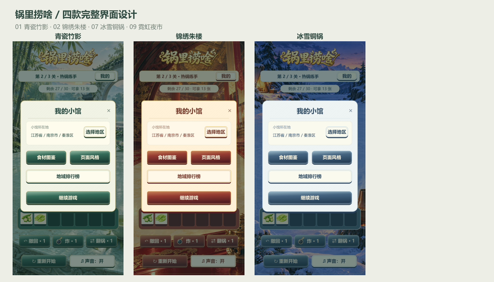

# 锅里捞啥 · 方案 1 / 2 / 7 / 9 完整界面设计

本目录保存静态视觉稿与交互说明。四套界面已接入游戏，实际画面见[运行截图](../implemented-1279/runtime)，构建包和导入说明见[交付说明](../../doc/四套UI落地与微信小游戏交付-2026-10-29.md)。

以十版方案的 V2 场景为准：1 青瓷竹影 / 2 锦绣朱楼 / 7 冰雪铜锅 / 9 霓虹夜市。复用原场景、标题及食材图片；重新设计面板、按钮、控件与信息层级。每套18张720×1520单页，共72张，附4张控件稿及8张总览。目录保留之前的名称。

本次修订：排行榜入口和页面标题统一使用「地域排行榜」；底部「炸」按钮左侧使用现有游戏的实心炸弹形状，包含铁壳、暖金描边、弯曲引线和火花，替换星形符号。三套单页和总览均同步更新。

| 方案 | 页面总览 | 弹框与状态总览 | 按钮和控件 |
|---|---|---|---|
| 01 青瓷竹影 | [查看](style-01-pages.png) | [查看](style-01-dialogs.png) | [查看](style-01-components.png) |
| 02 锦绣朱楼 | [查看](style-02-pages.png) | [查看](style-02-dialogs.png) | [查看](style-02-components.png) |
| 07 冰雪铜锅 | [查看](style-07-pages.png) | [查看](style-07-dialogs.png) | [查看](style-07-components.png) |
| 09 霓虹夜市 | [查看](style-09-pages.png) | [查看](style-09-dialogs.png) | [查看](style-09-components.png) |

## 视觉方向

- 青瓷竹影：月白釉面、青绿按钮、淡竹纹面板、暖金细边。安静清爽，图鉴使用温润卡片。
- 锦绣朱楼：朱红漆面、黄铜细边和暖纸卡片，延续宫宴厅堂的暖色层次。
- 冰雪铜锅：霜白面板、蓝灰按钮、冰晶色描边，背景里的铜锅提供暖色。保持清晰的冷暖层次。
- 霓虹夜市：深蓝金属面板、青色描边、紫色流光按钮和琥珀色成就点缀；大段文字使用浅色，菜品保留原色。

四款使用相同的信息层级、布局和操作顺序，方便直接比较材质、颜色、阅读感受。

## 每个页面和按钮的行为设计

以下为设计时的交互规划；当前实现和验证范围以交付说明为准。

| 图号 | 页面 / 弹框 | 按钮与跳转 |
|---|---|---|
| 01 | 游戏主界面 | 我的→02；食材→托盘，三张自动消除；撤回/炸/翻锅使用对应道具；重新开始→13；声音开关即时切换 |
| 02 | 我的小馆 | 选择地区→03；食材图鉴→06；页面风格→05；地域榜→14；继续游戏和关闭→01 |
| 03 | 选择地区 | 点省/市面包屑返回上级，地区行逐级选择；搜索时显示匹配结果；末级选中后保存→04；关闭返回02且不保存 |
| 04 | 地区保存确认 | 确认保存→02并显示保存反馈；再选一下→03且保留待选地区；关闭等同再选一下 |
| 05 | 页面风格 | 1/7/9卡片选中后先在本页预览；应用后返回02、保存本机偏好；关闭不提交。当前稿仅展示本次评审的三款，现有游戏主题列表没有改动 |
| 06 | 食材图鉴 | 两页签切换06/08；纵向滚动50种食材；已点亮卡片→07；未点亮卡片显示发现方法；返回我的或关闭→02 |
| 07 | 食材详情 | 返回图鉴或关闭→06，恢复原来的列表滚动位置。未知食材只显示问号与点亮方式，不泄露名称 |
| 08 | 我的成就 | 图鉴页签→06；上下滚动14项成就，展示进度与达成状态；返回我的或关闭→02 |
| 09 | 普通通关 | 下一关与返回游戏都进入下一关；关闭也进入下一关，避免停留在已清空棋盘 |
| 10 | 最终通关 | 再玩一遍、返回游戏、关闭均回第一关；保留永久图鉴与成就 |
| 11 | 首次失败复活 | 免费复活一次→01，前三张移入暂存区；重新开始→13；关闭返回失败棋盘并保留再次打开结果的入口 |
| 12 | 复活已用完 | 复活按钮禁用，主操作为重新开始→13；关闭返回失败棋盘 |
| 13 | 重新开始确认 | 主操作继续当前游戏→原页面；确定重新开始→当前关新局；关闭=取消。弱化破坏进度操作，防止误触 |
| 14 | 地域排行榜 | 行点击查看下一级地区排名，面包屑返回上级；当前地区卡片展示归属；返回我的或关闭→02 |
| 15 | 存档冲突 | 继续云端进度=采用云档；保留当前进度=采用本机档，操作后回01；关闭暂不做覆盖，保留本机进度等待后续处理 |
| 16 | 地区搜索空状态 | 清空搜索→03；返回地区列表→03；关闭→02。空状态不提供无效的保存按钮 |
| 17 | 隐藏调试面板 | 按后台配置先点小馆珍藏，再点图鉴页签进入；关卡按钮选择关卡；三个道具独立切换无限；保留3张的按钮缩减本关；返回游戏/关闭→01 |
| 18 | 加载与反馈 | 翻锅中阻止重复操作，完成后恢复；保存成功显示1.8秒轻提示；读取/搜索加载保持面板尺寸，失败显示重试入口 |

样例中 23/50、6/14、各地排名次数与存档张数用于版式展示，不是真实账号数据；当前源码实际已包含50种食材。

## 控件规格与交互状态

统一720设计宽度。常规主按钮高78～82、字30；次按钮同高度；关闭触控区域至少88×88、图形可小于触控区。图鉴页签和地区短按钮扩大隐形触控区，正文24～28。面板左右边距36，主要卡片宽544；双列按钮间距24。

主按钮采用深色渐变、边框和底部厚度；次按钮使用浅色或深色卡片底；按下时下移4px、压低高光，释放100ms复原。禁用降低饱和度且无按压反馈；次数0与∞保留同一数字位。选中同时使用描边与勾选，不只依赖颜色。

弹框180ms淡入，背景遮罩阻止棋盘误点；点击遮罩不关闭，统一使用关闭或返回。食材图鉴和地区列表使用裁剪滚动区，底部返回/保存按钮固定。打开子页面后返回上一级，保留筛选、滚动位置和待选值。

动效与交互以上述说明表达，PNG展示静态终态。尚未绘制排行榜网络错误的单独整页，复用18号反馈语言：当前列表原位保留，提示错误原因并提供重试。长屏时面板居中，列表可延展；短屏时整体缩放至安全区，正文不挤压按钮。

## 图片索引

单页位于 `style-01/01.png`～`18.png`，另外两套目录相同编号。图01～08为主流程，09～18为结果、异常状态与调试流程。`manifest.json`列出全部图号名称。原十版方案与原插画均保留，没有覆盖。
